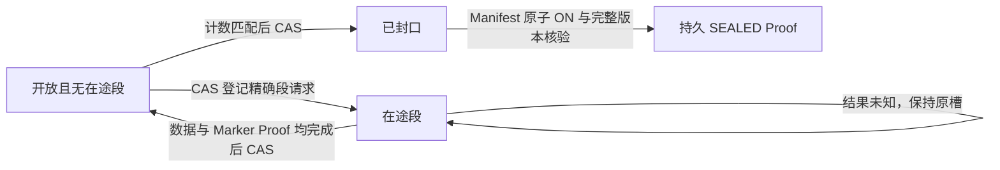

# Recording 原生 Manifest 与 CAS 写入封口

> 日期：2026-10-28
> 基线：f676adf42a2bc26bc4f0bdb7a61493b980059210
> 状态：存储组件及真实 MinIO 验证完成；正式 Node/控制面接入与 Hold 所有权交接仍缺。

## 实际协议

新增 ObjectArchive seal_recording_held_upload 及独立 writer 模块。上传 AUTHORITY 提升为
schema 2，Scope 自身的 v1 序列化保持不变；新的可写路径只允许 v2 脱敏策略元数据。
老的 v1 保全写入器因不可变 AUTHORITY 不匹配而拒绝，不静默升级旧 Recording。
v1 已有 Receipt 仍可只读核对，不能继续追加、创建新 writer 或生成封口证明。

每段上传数据与 Marker 之前，先对共享对象存储 WRITER 做强 ETag/Version CAS，登记
精确段序号、原始请求 Hash、计数和时间范围。只有两个对象的精确版本都已上传且形成
COMMITTED Proof，才以原 CAS token 释放写槽并累计段/帧/脱敏计数。不同段不能抢占，
相同请求可核对恢复；旧完成者不能覆盖新 token。每次状态写入改变 Revision/随机 Nonce，
防止相同内容复原造成 ABA。未知写槽没有超时释放或租约到期清空路径。

- 段号必须连续，已完成段的重放只读，不重新登记写槽、累计计数或上传数据。
- WRITER 当前缺失时，额外检查其历史版本/Delete Marker 与写入意图历史；出现过的
  fence 或孤立意图不能被当成新 Recording 重建，不按“当前404”推断安全。
- 封口须看到无在途槽，段/帧/脱敏计数与持久累计值一致，并覆盖实际时间范围；CAS
  成功后绑定精确 Manifest Hash，不允许改请求或再追加。
- 最终 COMMITTED Manifest 首次 create-only PUT 同时带原生 ON，沿用逐对象 PREPARED
  单次派发/未知只读核对约束。最后一个 Manifest 也具备精确版本所有权证明。
- 封口逐段核验原 COMMITTED/PREPARED、版本身份/Nonce/Hash/大小/原生 ON，读取精确
  Marker 验证序号/计数/时间；数据版本沿用上传与 ACK 已验证的内容 Hash，不重新读取
  整段视频或运行 OCR。最终全版本集合必须恰好等于全部自有数据、Marker 与 Manifest，
  不能承接外部 ON、额外历史版本或 Delete Marker。
- 核对集合后以不可变 SEALED 回执绑定 Scope、Manifest、完整 Inventory Hash、writer
  Revision/Nonce 与完成时间；重放返回同一 Proof。拒绝既有删除/最终 Hold 意图，不能
  用封口跨越未知删除。原最终 Hold 执行器的“初始必须 OFF”规则未改，没有自动承接 ON。

这里证明的是参与 v2 协议的受控存储写入路径的封口。更早、完全不识别上传 AUTHORITY
的普通 Helper，仍须在正式激活前以部署资格/Placement/旧在途请求围栏排除。当前没有
正式授权、跨 Node 原始写入器静默证明或可发布的全局解除保证，不能以此直接放行 OFF。

## 验证

OrbStack Running / context orbstack / OS=OrbStack 后，最终专用 MinIO Gate **14项库 +
3项真实 IPC = 17 passed / 0 failed / 0 skipped**，含原 ACK/Holder 用例。新增6项：

1. 两段封口后5个版本全部原生 ON，Manifest 版本无法删除；错误帧计数在封口前拒绝，
   正确请求仍可成功；重放 Proof 一致，晚到追加拒绝，已完成段仍可只读核对供 ACK。
2. 重建“CAS 写槽已提交、尚未派发”的未知状态，两次封口与不同段追加均拒绝，原槽
   完全不变；没有 Manifest 或额外数据版本。
3. 两个独立 Archive 控制器竞争“封口/追加”：封口获胜则追加拒绝；追加获胜则旧计数
   不能封口，随后以新计数成功。没有在成功封口后新增的数据版本。
4. 插入一个外部历史 ON 版本后拒绝 SEALED Proof，原生外部 ON 保留，未通过删除或
   改清单把它纳入自有可解除集合。
5. 按旧 schema 1 重建完整自有段/Proof，仍可只读校验；新追加与封口拒绝，不创建 writer。
6. 对实际 WRITER 创建 S3 Delete Marker 后不能重开该 lineage，旧版本与 Marker 数量
   不变，已有数据仍保留。新增历史检查后重跑完整17项，未用之前16项拼接结果。

全 Workspace/全部 targets 严格 Clippy、格式检查通过。像素与段元数据为明确合成夹具，
未知窗口通过重建状态模拟，未实际 kill 进程或跑真实 Recorder/OCR/客户负载。
私有日志 /tmp/agentbrowser-upload-seal-minio-final.log、
/tmp/agentbrowser-upload-seal-clippy-final.log。

首轮编译因 Inventory 类型没有 Serialize 实现失败，已改为与既有 Hold 一致的规范
Key/Version tuple Hash；未更改旧类型的存储契约或减少核验。所有关键写入仍有预算，
封口总预算120秒；大型录制的分阶段核验/容量/长稳仍须验证，类型上限不是性能证书。

## 已核验 CI、清理与剩余

基线 f676adf 的主 CI **40686294652**、Desktop **40686294673** 精确 SHA 全部成功；
读取 Verify 日志确认真实 ACK 用例及 UNKNOWN 拒绝 Gate 实际执行，完整 Integration/
GameDay 成功。progress300 已收尾。本提交仍须自己的完整 CI。

本轮专用测试容器/网络均已定向回收；以本轮构建 digest 验证来源且确认无容器引用后，
删除两个测试 MinIO/mc 镜像。其余8个容器、共用基础镜像/缓存及用户文件保留，未用
全局 prune。清理记录 /tmp/agentbrowser-upload-seal-cleanup.json。

仍缺封口 Helper IPC/Node/Recorder 正式调用、PostgreSQL 活动录制与权威上传授权、
最终上传 Seal Proof 到 Hold 队列的显式引用与安全承接、部署资格与旧写入器围栏、跨
Node/真实故障及目标云 Gate。原十一项其他真实外部系统、客户 Replay、Linux/Region/
组织与许可证范围全部保留，不满足 V16 生产发布条件。
